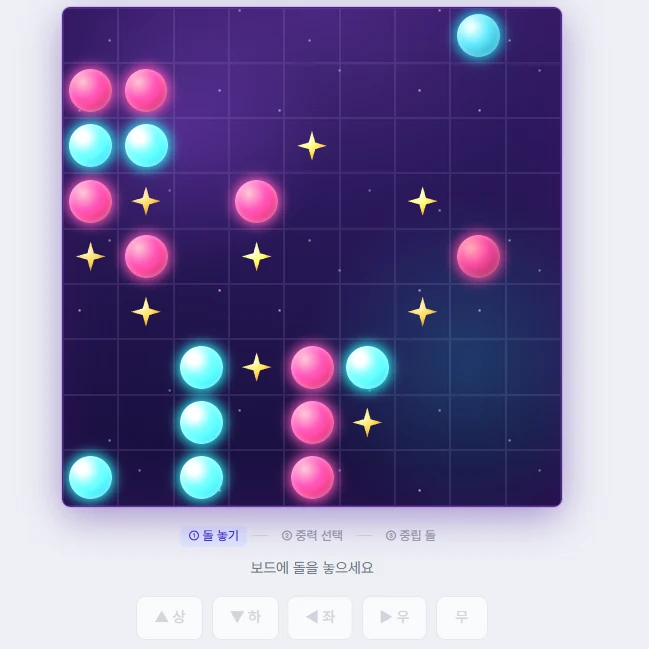
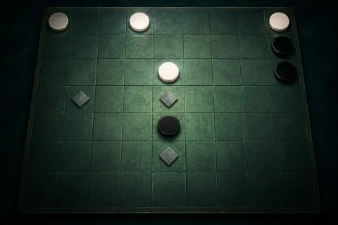
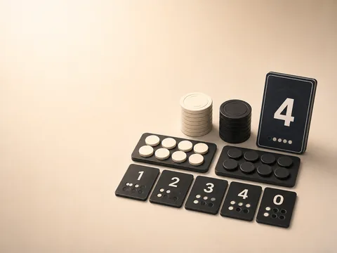
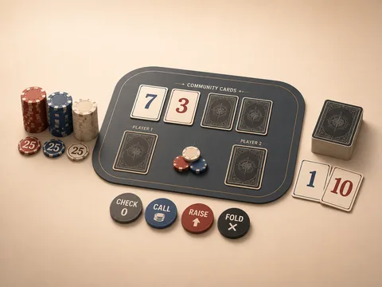
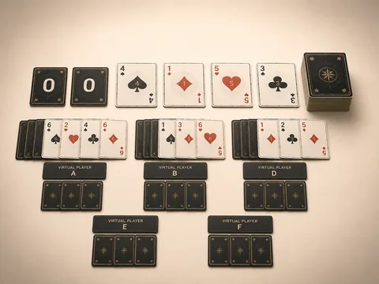
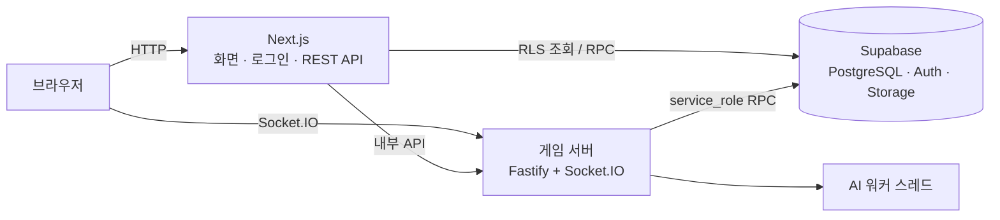

<p align="center">
  
</p>

<h3 align="center">브라우저에서 바로 하는 1:1 두뇌 게임 플랫폼</h3>

<p align="center">
  <a href="https://genius.choen.kr"><b>genius.choen.kr</b></a>
  <br>
  2026.03 개발 시작 · 2026.04 서비스 오픈 · 2인 개발
</p>

<br>

커스텀 데스매치는 사목, 장기 같은 보드게임부터 상대의 패를 읽고 베팅하는 심리 게임, 숫자·단어 퍼즐까지 35종의 게임을 브라우저에서 바로 할 수 있는 사이트입니다. 카카오 계정으로 로그인한 뒤 방을 만들어 친구와 두거나, 랭크 매칭으로 모르는 상대와 붙을 수 있습니다. 판이 끝나면 전적과 기보가 남고, 랭크 점수에 따라 티어가 오르내립니다.

2026년 4월 말에 공개한 뒤 실제 사용자를 받으며 계속 운영하고 있습니다.

<br>

## 운영 현황

2026년 11월 26일 기준으로 운영 DB에서 집계했습니다. 운영용 계정과 그 계정이 둔 판은 제외했습니다.

| 항목 | 수치 |
|------|------|
| 가입 회원 | 131명 |
| 누적 게임 | 16,540판 (사람끼리 둔 판 13,983판) |
| 랭크전 | 10,758판, 현재 시즌 5 진행 중 |
| 월간 플레이 회원 | 최대 72명 (2026년 10월) |
| 하루 최다 게임 | 421판 |

<br>

## 화면

<p align="center">
  
  <br>
  <sub>사중력 사목 플레이 화면</sub>
</p>

<table>
  <tr>
    <td align="center" width="25%"><br><sub>사중력 사목</sub></td>
    <td align="center" width="25%"><br><sub>넘버4</sub></td>
    <td align="center" width="25%"><br><sub>인디언 홀덤</sub></td>
    <td align="center" width="25%"><br><sub>흑과백2</sub></td>
  </tr>
  <tr>
    <td align="center"><br><sub>콰트로</sub></td>
    <td align="center"><br><sub>삼층 오목</sub></td>
    <td align="center"><br><sub>시드섯다</sub></td>
    <td align="center"><br><sub>양면포커</sub></td>
  </tr>
</table>

<br>

## 주요 기능

- **게임 35종**: 상설 게임 32종과, 기간 한정 이벤트·길드전에서만 열리는 게임 3종이 있습니다. 27종은 컴퓨터와도 둘 수 있습니다.
- **방과 관전**: 선후공, 제한 시간, 무르기 같은 옵션을 방마다 정할 수 있습니다. 관전자도 같은 채팅에 참여하고, 끝난 판은 기보 화면에서 다시 볼 수 있습니다.
- **랭크**: 배치 5판을 거쳐 브론즈부터 챌린저까지 티어가 정해집니다. 매칭이 잡히면 두 사람이 밴픽으로 이번 판 게임을 고릅니다. 시즌이 끝나면 순위에 따라 우편함으로 보상이 지급됩니다.
- **꾸미기**: 랭크전으로 모은 재화로 상점과 뽑기를 이용할 수 있습니다. 닉네임 옆 칭호, 움직이는 칭호 이펙트, 게임판 스킨, 익명으로 플레이하는 아이템 등이 있습니다.
- **길드**: 길드 채팅과 공지, 길드 포인트 상점, 랭크 결과를 합산한 길드 순위, 기간 한정 길드전이 있습니다.
- **운영 도구**: 관리자 페이지에서 회원 정지, 신고·문의 처리, 공지, 상점 상품, 게임 규칙을 관리합니다.

<br>

## 업데이트 기록

커밋 기록과 운영 DB를 바탕으로 정리했습니다. 판 수와 플레이 회원 수는 그달에 저장된 게임 기록 기준입니다.

| 월 | 주요 업데이트 | 게임 수 | 플레이 회원 |
|----|---------------|--------:|------------:|
| 2026.03 | 개발 시작. 닉네임만 입력하고 들어오는 첫 버전(현재 `/classic`)과 사중력 사목 | - | - |
| 2026.04 | 양면장기, 넘버4, 인디언 홀덤, 흑과백2, 해달별2, 은행놀이 등 게임 13종 추가. 월말에 카카오 로그인 회원제로 공개 | 2 | 2 |
| 2026.05 | 랭크 시즌 1 시작, 밴픽, 상점, 히든 칭호, 인디언 홀덤 이벤트 | 2,936 | 41 |
| 2026.06 | 시즌 2, 게임판 스킨, 뽑기, 레전드 칭호, 해달별 이벤트 | 1,513 | 30 |
| 2026.07 | 시즌 3 대규모 업데이트(길드, 모바일 화면, 테마 개편, 규칙 편집기). 콰트로, 단어조합, 트랜스레터 추가 | 777 | 41 |
| 2026.08 | 비로그인 방문자용 소개·규칙 페이지, 길드 개편, 우편함. 수식완성N, 컴플릿 결! 합!, 킹메이킹, 나이트의 여행, 삼층 오목, 초이스 홀덤, 시드섯다 추가 | 738 | 28 |
| 2026.09 | 시즌 4, 모바일 랭크 화면과 대기실 개편, 일반 계정 로그인 연동, 한가위 이벤트, 첫 길드전. 양면포커, 명추리 추가 | 5,407 | 60 |
| 2026.10 | 길드 공헌도, 문의 답변 우편함 발송. 에스키모, 이별 공식, 루프체크, 모음이 없어요 추가. Supabase 전송량 한도 초과로 서비스 중단 후 복구 | 4,071 | 72 |
| 2026.11 | 시즌 5, 레전드 칭호 '창공의 청룡', 크리스마스 이벤트 준비 중 | 1,096 | 54 |

<br>

## 아키텍처



- 게임 규칙 판정은 모두 게임 서버에서 합니다. 클라이언트는 어디에 두겠다는 입력만 보내고, 서버가 검증한 결과를 받아 화면에 그립니다.
- 진행 중인 방과 게임 상태는 게임 서버 메모리에 둡니다. 판이 끝나면 결과와 기보를 DB에 저장합니다.
- 재화, 아이템, 칭호를 바꾸는 작업은 모두 PostgreSQL 함수(RPC) 안에서 처리합니다. 이 함수들은 service_role 키로만 호출할 수 있고, 클라이언트는 RLS 정책에 따라 자기 데이터만 조회할 수 있습니다.
- 클라이언트와 서버가 같이 쓰는 타입과 규칙 판정 코드는 `shared/`에 모아 두었습니다. 화면에서 둘 수 있는 칸을 표시하는 코드와 서버가 수를 검증하는 코드가 같습니다.
- 시간이 오래 걸리는 AI 탐색은 방마다 별도 워커 스레드에서 실행합니다. AI가 생각하는 동안에도 다른 방의 진행은 막히지 않습니다.
- 카카오 로그인은 Supabase 기본 연동 대신 OAuth를 직접 구현했습니다. 이메일 동의 항목을 받지 않아도 되어서 카카오 비즈니스 인증 없이 로그인을 제공할 수 있습니다.

<br>

## 기술 스택

| 구분 | 기술 |
|------|------|
| 프론트엔드 | Next.js 16 (App Router), React 19, TypeScript, Tailwind CSS v4, Zustand, Framer Motion |
| 게임 서버 | Node.js, Fastify 5, Socket.IO 4, worker_threads |
| DB · 인증 | Supabase (PostgreSQL, RLS, RPC, Storage), 카카오 OAuth |
| 테스트 | Vitest (테스트 파일 142개) |
| 빌드 · 배포 | pnpm workspace, tsup, PM2 |

<br>

## 트러블슈팅

자세한 내용은 [docs/troubleshooting.md](docs/troubleshooting.md)에 정리했습니다.

- [숨겨야 할 카드가 클라이언트로 넘어가는 문제](docs/troubleshooting.md#1-숨겨야-할-카드가-클라이언트로-넘어가는-문제)
- [운영 중인 길드를 건드리지 않고 새로 만들기](docs/troubleshooting.md#2-운영-중인-길드를-건드리지-않고-새로-만들기)
- [Supabase 무료 한도 초과로 서비스가 멈춘 일](docs/troubleshooting.md#3-supabase-무료-한도-초과로-서비스가-멈춘-일)

<br>

## 폴더 구조

```
app/                 페이지와 API 라우트
components/
  cdm/               공통 UI 컴포넌트, 칭호 뱃지와 이펙트
  game/modules/      게임별 화면
hooks/  stores/      소켓 연결, 로비·방 상태
lib/                 Supabase 클라이언트, 인증, 랭크·상점·뽑기·길드 로직
shared/              클라이언트·서버 공용 타입과 규칙 판정
server/src/
  socket/            소켓 이벤트 처리, games/ 아래 게임별 서버 로직
  store/             방·세션·랭크 대기열 (메모리)
  rank/ shop/ guild/
  __tests__/
db/                  운영 중 적용한 SQL 패치
classic-era/         첫 버전 화면 (/classic)
middleware.ts        로그인·정지·관리자 접근 제어
```

<br>

## 로컬 실행

```bash
pnpm install
cp .env.example .env.local
cp server/.env.example server/.env
pnpm dev
```

`pnpm dev`를 실행하면 프론트(3001)와 게임 서버(4001)가 함께 뜹니다. 하나만 띄우려면 `pnpm dev:front`나 `pnpm dev:server`를 쓰면 됩니다. 테스트는 `pnpm test`로 실행합니다.

로그인과 전적, 상점 기능을 쓰려면 Supabase 프로젝트와 카카오 앱 키가 필요합니다. 이 저장소는 운영 저장소에서 키, 배포 설정, 내부 문서를 제외한 공개용 사본이라 DB 기본 스키마가 포함되어 있지 않습니다. `db/` 폴더에는 운영 중에 추가로 적용한 패치만 있습니다.
